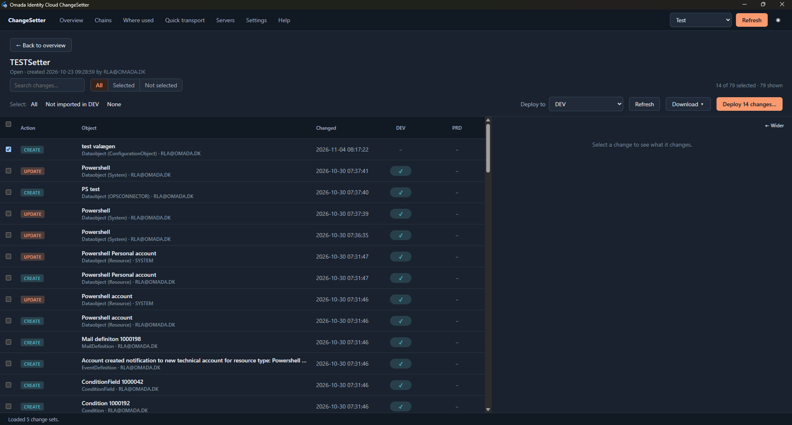

# Omada Identity Cloud ChangeSetter

The Omada Identity Cloud ChangeSetter is a Windows desktop client for working with change sets on Omada Identity Cloud environments. It lets you pick individual changes from a change set on a source environment, or from a change set file, and deploy them to a target environment. It also provides an overview of how changes are deployed in each configuration chain.

## Installation
1. Install .NET 10 Desktop runtime
2. Download tool from releases list
3. Select installer properties -> Unblock File
4. Run the installer
5. Start the tool and review the information available in the help menu in the application
